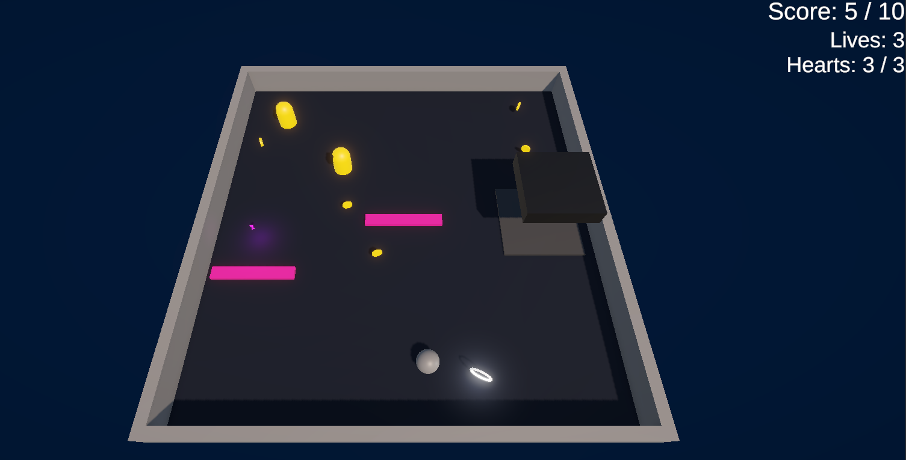
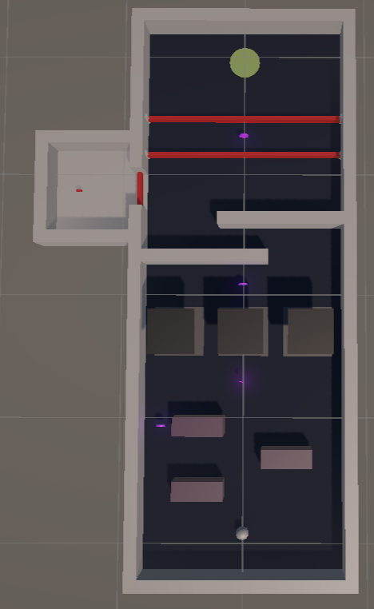
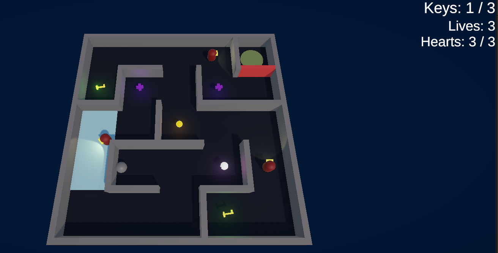
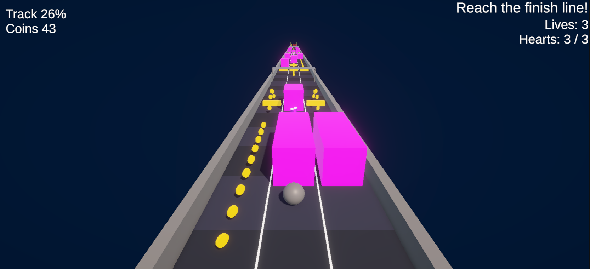
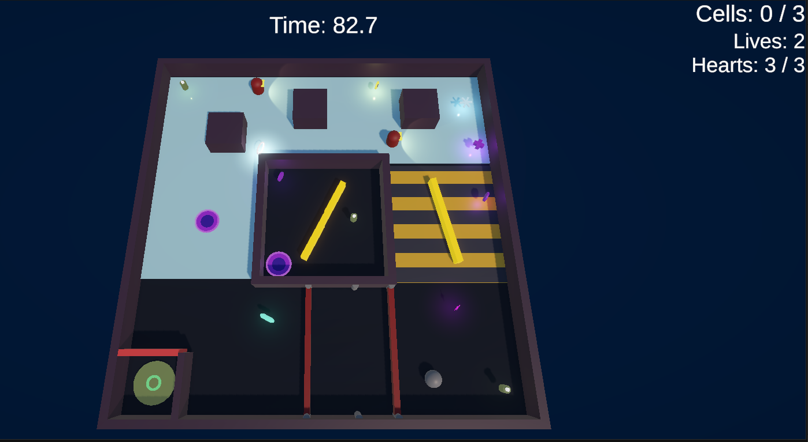
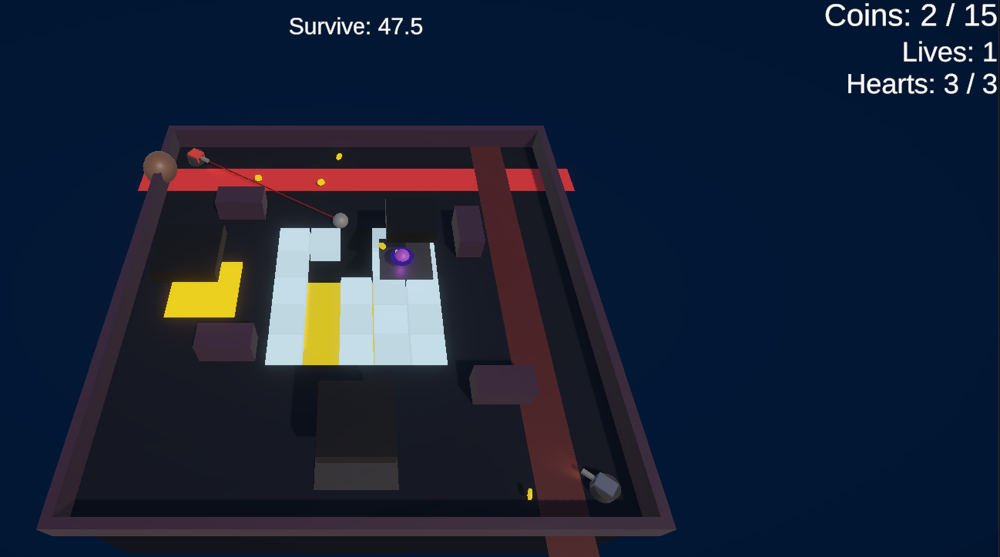

# Ball Mini Games: a 6-Level Unity Arcade Game

We start from Lecture 07 prototype (**Level 0**) and extended that into six different levels levels, each with its own layout, objective, hazards, pickups, power-ups and health rules, and the difficulty rises from Level 1 to Level 5.

**Note: Most of the code used in the scripts are of juice and game feel gathered from upcoming labs code and unity tutorial projects over github.**

## Screenshots

---

## Controls

| Input                              | Action                                    | Levels        |
| ---------------------------------- | ----------------------------------------- | ------------- |
| **Arrow keys**                     | Roll the ball                             | 0, 1, 2, 4, 5 |
| **Left and Right Arrows**          | Switch lane                               | 3             |
| **Space or Up Arrow**              | Jump                                      | 3             |
| **Space**                          | Dash (after collecting the Dash power-up) | 4, 5          |
| **E**                              | Fire a stored EMP pulse                   | 2             |
| **Restart and Next Level buttons** | On the win and lose panels                | All           |

---

## Core functionality shared by all levels

### Health, hearts and lives

- The player has **hearts** (`Health.Max` is kept as 3) and **lives** (kept in `GameManager`).
- A hit `damage` the hearts and starts **invulnerability frames** (`iFrames` kept default as 1 s). The ball blinks while invulnerable.
- At 0 hearts the ball dies with a burst, a camera shake and a short hit-stop. One life is removed and if other lives remain the ball gets respawned after 0.6 s with full hearts for that life and 1.5 s of spawn protection. With no lives left, the lose panel appears.
- A **shield** absorbs exactly one hit, without losing a heart.

### Clearing level objectives

The following winning condition objective enum was created:

| Objective      | Wins when                                                                  | Used in                       |
| -------------- | -------------------------------------------------------------------------- | ----------------------------- |
| `CollectCoins` | Score reaches Target Score                                                 | Level 0                       |
| `ReachGoal`    | Player touches the Goal                                                    | Levels 1 and 3                |
| `CollectKeys`  | Required keys or cells are collected, and the player then touches the Goal | Levels 2 (keys) and 4 (cells) |
| `Survive`      | The timer ends with at least Target Score coins                            | Level 5                       |

Some additional features are also added with provision from inspector fields like a **timer** (`timeLimit`), **death time penalty**, **bonus time** from the blue-coin bonus, and a **slow-timer** effect.

### Juice (feedback effects)

`JuiceFx` provides one-line helpers used everywhere:

- `Burst`: a particle burst
- `Ring`: an expanding ring on victory moment (also includes collecting a coin)
- `FloatingText`: rising "+1", "-1", "KEY 1/3" text when collecting a collectable
- Shared colours (gold, shield cyan, speed blue, damage red)

Other effects comes from `CameraShake`, `PlayerJuice` (body flash, blink, trail, hit-stop), `SpawnPopIn`, `PanelPopIn`, `UiPunch` and `PickupSpinAndBob`.

### Freeze

`FreezeEffect` is a static timer. While active, lasers, crushers, boulders, turrets, bullets, chasers, spinners and guards all stop and turn icy blue, and none of them can hurt the player. A sepcial powerup effect for last level 5.

---

## 5. Level summary table

| #   | Name           | Objective                    | Time limit             | Lives / Hearts       | Signature hazards                                                                       | Signature power-ups                      |
| --- | -------------- | ---------------------------- | ---------------------- | -------------------- | --------------------------------------------------------------------------------------- | ---------------------------------------- |
| 0   | Coin Collector | Collect 10 coins             | None                   | 3 / 3                | Ping-pong guard, square-patrol guard, central spikes, crusher                           | Shield, Speed                            |
| 1   | Beat the Clock | Reach the goal               | 45 s                   | 3 / 3                | 3 staggered crushers, 2 easing sliding walls, 3 laser gates                             | Time +5 s, Speed, Red coin (bonus +10 s) |
| 2   | Guard Maze     | Collect 3 keys, then exit    | None                   | 3 / 3                | 3 guards using AI Navigation package NavMesh (Patrol, Spot, Chase, Search, Return), ice | Heart, Ghost, EMP                        |
| 3   | Subway Run     | Finish a 440 m, 3-lane track | None                   | 3 / 3, 2 checkpoints | Trains, low barriers, oncoming trains                                                   | Magnet, Spring, Shield, Heart            |
| 4   | Ice and Lasers | Collect 3 cells, then exit   | 90 s (death costs 8 s) | **2** / 3            | Ice, laser wave, conveyor, spinners, 2 sight-cone guards, teleport vault                | Dash, Freeze, Slow-mo, Time +8 s         |
| 5   | Final Gauntlet | Survive 60 s with 15+ coins  | 60 s                   | **1** / 3            | Turrets, collapsing tiles over a pit, boulders, 3 chasers, hunter crusher               | Coins x2, Dash, Freeze, Shield           |

## Power-ups

| Power-up    | Colour      | Duration / use              | Levels     | Notes                                           |
| ----------- | ----------- | --------------------------- | ---------- | ----------------------------------------------- |
| Shield      | Cyan        | 1 hit                       | 0, 3, 5    | White hollow ring with glow                     |
| Speed       | Blue        | 5 s, x1.6                   | 0, 1, 4    | Lightning bolt with blue trail and sparks       |
| Ghost       | White-blue  | 5 s                         | 2          | Invisible to guards, passes through guards only |
| EMP         | Orange      | 1 charge, key **E**         | 2          | Stuns guards in 9 units for 4 s                 |
| Magnet      | Magenta     | 8 s                         | 3          | Pulls coins within 7 units                      |
| Spring      | Lime        | 1 jump                      | 3          | Mega jump (speed 13)                            |
| Dash        | Teal        | 20 s window, 1.5 s cooldown | 4, 5       | Space, speed 16 for 0.2 s                       |
| Freeze      | Light blue  | 5 s                         | 4, 5       | Stops all enemies and hazards                   |
| Slow-mo     | Pale yellow | 8 s, 35%                    | 4          | Slows the timer only                            |
| Coins x2    | Gold        | 8 s                         | 5          | Doubles coin score                              |
| Time pickup | Purple      | +5 s (L1) or +8 s (L4)      | 1, 4       | Adds to the timer                               |
| Heart       | Pink        | +1 heart                    | 2, 3, 4, 5 | Waits if you're at full hearts                  |

---

## Hazards

| Hazard                         | Script                      | Levels  | Core idea                                              |
| ------------------------------ | --------------------------- | ------- | ------------------------------------------------------ |
| Patrol guard (ping-pong, loop) | `EnemyPatrol`               | 0       | Fixed route, contact damage                            |
| Spikes                         | `Hazard`                    | 0       | Always dangerous                                       |
| Crusher                        | `Hazard`                    | 0, 1, 5 | Rest, warn, slam cycle with optional start delay       |
| Hunter crusher                 | `Hazard` + `CrusherTracker` | 5       | Follows you while resting                              |
| Sliding wall (easing)          | `EasedMover`                | 1       | SmoothStep and Bounce curves                           |
| Laser gate                     | `LaserGate` + `Hazard`      | 1, 4    | Off, blinking warning, on                              |
| AI guard                       | `GuardAI` + `NavMeshAgent`  | 2, 4    | Patrol, Spot, Chase, Search, Return with raycast sight |
| Ice                            | `IceZone`                   | 2, 4    | Low grip                                               |
| Conveyor                       | `ConveyorBelt`              | 4       | Continuous push                                        |
| Spinner                        | `Spinner`                   | 4       | Rotating bar                                           |
| Teleport pad                   | `TeleportPad`               | 4       | Linked pair                                            |
| Train / barrier                | `Hazard` (trigger)          | 3       | Lane-based obstacles                                   |
| Oncoming train                 | `OncomingTrain`             | 3       | Activates by distance                                  |
| Turret                         | `Turret` + `Projectile`     | 5       | Sweep, aim, fire                                       |
| Collapsing tile and pit        | `CollapsingTile`, `PitZone` | 5       | Crumble, drop, rebuild                                 |
| Boulder lane                   | `BoulderLane`               | 5       | Flashing warning then roll                             |
| Chaser drone                   | `Chaser`                    | 5       | Chase, telegraph, lunge, recover                       |

### Pickups and abilities

`Coin`, `BlueCoin`, `RedCoin`, `PowerUp` (enum-driven: Speed, Shield, Ghost, Emp, Magnet, Spring, Dash, Freeze, SlowTime, CoinX2), `TimePickup`, `KeyPickup` (also the power cell), `HeartPickup`, `EmpAbility`, `MagnetAbility`, `DashAbility`, `PowerStatusHud`, `PickupSpinAndBob`.

### Hazards and AI Navigation Usage Guards

`Hazard`, `EnemyPatrol`, `GuardAI`, `EasedMover`, `LaserGate`, `IceZone`, `ConveyorBelt`, `Spinner`, `TeleportPad`, `Turret`, `Projectile`, `CollapsingTile`, `TileGrid`, `PitZone`, `BoulderLane`, `CrusherTracker`, `Chaser`, `OncomingTrain`.
